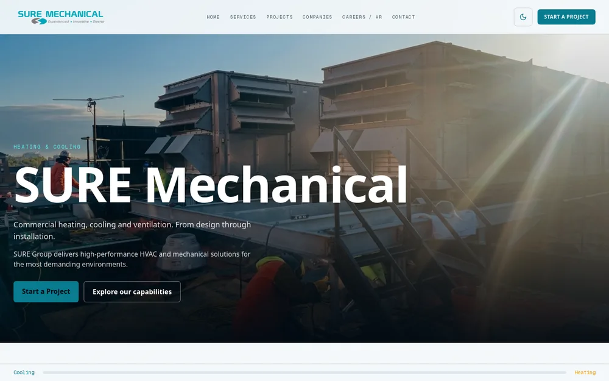
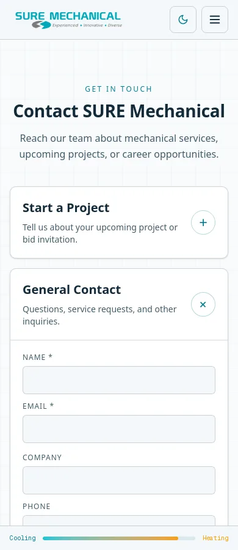
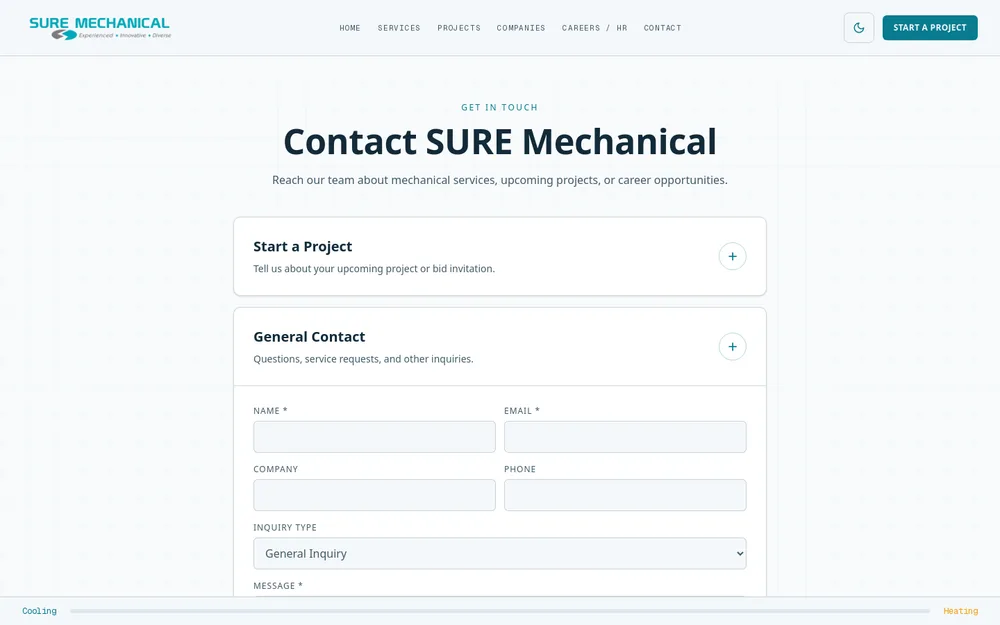

# Final client revision review captures

Static export tested November 14, 2026. No production deployment.

ESLint and static build passed. Browser checks passed at 390, 768 and 1440 pixels: section order, one main headline, all seven values, 9 photographed projects + 14 name-only projects, search, internal links, collapsed forms, light/dark themes, no horizontal overflow. Each of the three forms was tested with intercepted 422, 429, 200/rejected, 200/accepted and network errors. No live inquiries sent. Mobile scroll animation initialization also passed.

Browser tests use Chrome Headless Shell. Set BROWSER_EXECUTABLE_PATH if not using a Playwright-installed Chromium. `npm run test:browser` now runs the revision suite; the older verify-site.mjs contains preexisting obsolete mailto/card-count assumptions.

See ../final-client-review.md for sources, pending photograph, content approvals and account-level form delivery checks. No inbox-delivery claim is made.
